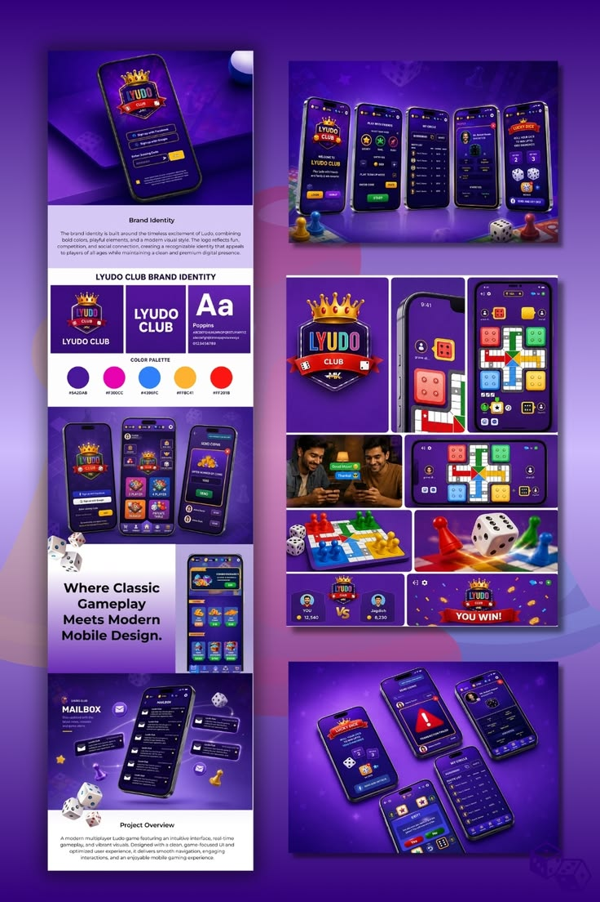

<p align="center">
  
</p>

<h1 align="center">Ludo Royale</h1>

<p align="center">
  A modern, responsive, classic Ludo board game built with React, TypeScript, Tailwind CSS, Cloud Firestore, and Email OTP authentication — ready for Vercel deployment.
</p>

---

## Visual Design Reference



---

## Key Features

### Game Modes
- **Play Online**: Automatic matchmaking via Cloud Firestore that connects players and transitions directly into a live game arena with synced turns and Quick Chat emotes.
- **Play with Friends**: Dedicated **Create Room** (generates a 6-character room code) and **Join Room** tabs for real-time private matches.
- **Play vs. Computer (Smart AI)**: Choose **Easy**, **Normal**, or **Hard** AI opponents with tactical capture, safe-square, and home-stretch heuristics.
- **Local Multiplayer**: Classic 2-, 3-, and 4-player Pass & Play on a single device.
- **Guest Mode**: Instant play against AI or locally without requiring sign-in; Email OTP sign-in is required for Online & Friends rooms.

### Classic Ludo Rules & Gameplay
- Exact **15×15 classic board** with 4 tokens per player and 8 safe star/start squares.
- Roll a **6** to deploy a token from the home yard onto the board.
- Bonus roll awarded on rolling **6**, capturing an opponent token, or reaching the center crown.
- Exact dice roll required to enter the center crown; automatic podium ranking and winner celebration.
- Optional **Three-Sixes Forfeit** rule toggle in Settings.
- **Smart Auto-Move**: Automatically moves your single legal token on rolls `1–5` or when only one unfinished token remains, while still letting you pick which token to move/deploy when rolling a `6` with multiple choices.

### Visuals, Audio & Personalization
- **Realistic 360° 3D Dice**: 6-faced 3D cube that spins 360°+ across X/Y/Z axes with jump bounce and dynamic shadow.
- **Selectable Board Themes**: **Royal Velvet** (Purple & Gold default), **Heritage Wood**, and **Midnight Arena**.
- **Profile & Rewards**: Custom display names, 4 illustrated character avatars, **Daily Lucky Dice** coin bonus, and Web Audio sound effects + ambient music toggles.

### Passwordless Email OTP & Sync
- Sign in with your email address using a **6-digit OTP** sent via SMTP (no Firebase Console Auth provider setup needed).
- First-time verified players automatically get a Cloud Firestore profile created and synced for coins, gems, wins, games played, display name, avatar, and daily bonus claims.

---

## Tech Stack

- **Frontend**: React 19, TypeScript, Tailwind CSS v4, Lucide Icons, Motion, Canvas Confetti
- **Game Engine & Audio**: Pure TypeScript Ludo state machine + Web Audio API synthesizer
- **Backend / Serverless API**: Express + Vite middleware for local development (`server.ts`) and Vercel Serverless Functions (`/api/auth/send-otp`, `/api/auth/verify-otp`, `/api/health`)
- **Email & Auth**: Nodemailer (SMTP SSL/TLS & STARTTLS) + stateless HMAC-SHA256 signed OTP challenges
- **Database**: Cloud Firestore (`firestore.rules` + `firebase-blueprint.json`)

---

## Project Structure

```text
├── api/
│   ├── _otpCore.js           # Stateless HMAC OTP generation, verification & SMTP mailer
│   ├── health.ts             # GET /api/health
│   └── auth/
│       ├── send-otp.ts       # POST /api/auth/send-otp
│       └── verify-otp.ts     # POST /api/auth/verify-otp
├── public/
│   ├── assets/aistudio/
│   │   └── image_4ed6c647.png
│   ├── favicon.ico
│   ├── logo.ico
│   └── logo.png
├── src/
│   ├── assets/images/        # Character avatars & crest artwork
│   ├── components/           # HomeDashboard, GameArena, LudoBoard, Dice3D, Modals, etc.
│   ├── engine/               # Classic Ludo rules, board coordinates, AI logic, types
│   ├── firebase/             # Firestore client, profile sync & real-time room service
│   └── services/             # Web Audio sound engine & local preferences storage
├── firestore.rules           # Firestore security & schema validation rules
├── firebase-blueprint.json   # Data entity schema blueprint
├── server.ts                 # Local Express + Vite dev/prod server
├── vercel.json               # Vercel build & Vite framework config
└── .env.example              # Template for environment variables
```

---

## Local Development

### 1. Install Dependencies
```bash
npm install
```

### 2. Configure Environment Variables
Copy `.env.example` to `.env` (never commit `.env` or real secrets):
```bash
cp .env.example .env
```

Fill in your own values in `.env`:

| Variable | Description | Example Placeholder |
|---|---|---|
| `SMTP_HOST` | Your SMTP provider hostname | `smtp.your-provider.com` |
| `SMTP_PORT` | `587` (STARTTLS), `465` (SSL/TLS), or `2525` | `587` |
| `SMTP_USER` | Your SMTP username / sender email | `noreply@your-domain.com` |
| `SMTP_PASS` | Your SMTP password / app key | `<your-smtp-password>` |
| `EMAIL_FROM` | Sender display name and address | `Ludo Royale <noreply@your-domain.com>` |
| `OTP_SECRET` | Long random HMAC signing secret (32+ chars) | `<random-32-char-secret>` |

### 3. Run the App
```bash
npm run dev
```
The app and `/api/*` endpoints run together on `http://localhost:3000`.

---

## Deploying to Vercel

1. Import the repository in **Vercel** (`vercel.json` is pre-configured with Vite output `dist` and `/api` serverless routes).
2. In **Vercel Project Settings → Environment Variables**, add the variables above (`SMTP_HOST`, `SMTP_PORT`, `SMTP_USER`, `SMTP_PASS`, `EMAIL_FROM`, `OTP_SECRET`) for **Production**, **Preview**, and **Development**.
3. Deploy (or **Redeploy** after saving environment variables).
4. Verify deployment health by visiting `/api/health` — it should return `{"ok":true,"emailOtpConfigured":true}`.

---

## Available Scripts

| Command | Description |
|---|---|
| `npm run dev` | Starts local Express + Vite development server on port 3000 |
| `npm run build` | Builds the production frontend bundle into `dist/` |
| `npm run start` | Runs the production Node server (`node server.ts`) |
| `npm run lint` | Runs TypeScript type-checking (`tsc --noEmit`) |

---

## Security Notes

- Keep all SMTP credentials, API keys, and `OTP_SECRET` strictly in server environment variables (`.env` locally or Vercel Environment Variables in production).
- Never commit `.env` or paste live passwords/tokens into source files or documentation.
- Review `firestore.rules` before opening your deployment to a wide public audience.
